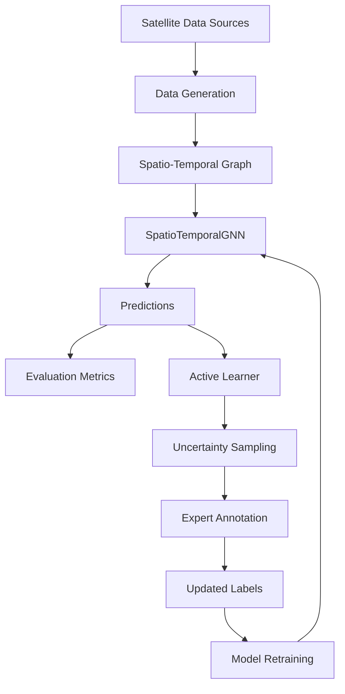

# System Architecture

## Overview

The Spatio-Temporal GNN & Active Learning Pipeline is designed for detecting environmental changes in satellite imagery through a combination of deep learning and human-in-the-loop active learning. The system processes multi-temporal, multi-spectral satellite data organized as spatio-temporal graphs and identifies regions where significant environmental changes have occurred.

## Components

### 1. Data Generation (`data/`)

The `data` module is responsible for generating synthetic spatio-temporal datasets that mimic real satellite observations. It includes:

- **SpatioTemporalData**: A data container class that holds multi-spectral features, adjacency matrices, and metadata.
- **generate_mock_sentinel.py**: A script that generates synthetic Sentinel-2-like data with realistic phenological patterns and injected change events.

Key features:
- Spatial regions distributed in a geographic area with coordinates
- Monthly temporal resolution with seasonal phenology patterns
- Four spectral bands (Blue, Green, Red, NIR) plus derived indices
- Spatial adjacency matrix computed using RBF kernel over distances
- Temporal adjacency matrix representing sequential month relationships
- Ground truth labels indicating stable vs. changed regions
- Metadata with change event information

### 2. Models (`models/`)

The `models` module implements the core neural network architectures:

- **SpatialGraphConv**: A spatial graph convolution layer that supports both PyG and dense matrix implementations
- **TemporalAttention**: A temporal attention mechanism to weigh the importance of different time steps
- **SpatioTemporalGNN**: The main model combining spatial and temporal processing for change detection

Key features:
- Spatial graph convolution layers for aggregating neighbor information
- Temporal modeling using either GRU or 1D Convolution
- Temporal attention to focus on most discriminative time periods
- Configurable architecture with different backbones

### 3. Active Learning Pipeline (`pipeline/`)

The `pipeline` module implements active learning strategies to identify the most informative samples for labeling:

- **calculate_uncertainty**: Functions to compute uncertainty scores using entropy, margin, or least confidence
- **ActiveLearner**: Main class that queries the top-K uncertain nodes for expert annotation

Key features:
- Multiple uncertainty sampling strategies
- Integration with the GNN model for uncertainty estimation
- Return of node indices and optionally uncertainty scores

### 4. Application (`app/`)

The `app` module contains visualization and reporting tools:

- **visualizer.py**: Tools for visualizing spatio-temporal data cubes, spatial graphs, and generating reports

Key features:
- Spectral time series plotting for individual regions
- Spatial graph topology visualization
- Textual change detection reports

### 5. Main Runner (`main.py`)

The main entry point that orchestrates the entire pipeline:

- Data generation
- Model training
- Evaluation before active learning
- Active learning query
- Simulation of expert annotation
- Reporting of results

Key features:
- Command-line interface with configurable parameters
- Full pipeline execution in a single command
- Support for different active learning strategies

## Data Flow

## Mathematical Details

### Spatial Graph Construction

Given spatial centroids $\mathbf{p}_i = (x_i, y_i) \in \mathbb{R}^2$ for region $i$:
$$A_{\text{spatial}}(i, j) = \exp\left( - \frac{\|\mathbf{p}_i - \mathbf{p}_j\|^2}{2 \sigma_s^2} \right) \cdot \mathbb{I}(\|\mathbf{p}_i - \mathbf{p}_j\| < \tau)$$

Normalized spatial graph Laplacian:
$$\widetilde{A}_{\text{spatial}} = \widetilde{D}^{-1/2} (A_{\text{spatial}} + I_N) \widetilde{D}^{-1/2}$$

### Spatio-Temporal GNN Forward Pass

For node features $X \in \mathbb{R}^{N \times T \times F}$:
1. **Spatial Aggregation (per timestamp $t$):**
   $$H_t = \text{ReLU}\left( \widetilde{A}_{\text{spatial}} X_t W_s + b_s \right)$$
2. **Temporal Modeling:**
   $$Z = \text{GRU}(H_1, H_2, \dots, H_T) \quad \text{or} \quad Z = \text{Conv1D}(H)$$
3. **Change Logits:**
   $$\hat{Y} = \text{Softmax}\left( \text{MLP}(Z) \right)$$

### Active Learning Query Strategies
- **Shannon Entropy**:
  $$\mathcal{U}_{\text{entropy}}(i) = - \sum_{c=1}^C P(y_i = c \mid X, A) \log P(y_i = c \mid X, A)$$
- **Margin Sampling**:
  $$\mathcal{U}_{\text{margin}}(i) = 1 - \left( P(y_i = \hat{c}_1 \mid X, A) - P(y_i = \hat{c}_2 \mid X, A) \right)$$
- **Least Confidence**:
  $$\mathcal{U}_{\text{conf}}(i) = 1 - \max_{c} P(y_i = c \mid X, A)$$

## Extensibility

The modular design allows for easy extension:

- New GNN architectures can be implemented in `models/`
- Additional active learning strategies can be added to `pipeline/`
- Different data sources can be integrated by extending the `data/` module
- Visualization tools can be enhanced in `app/`
